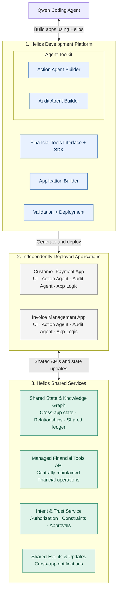
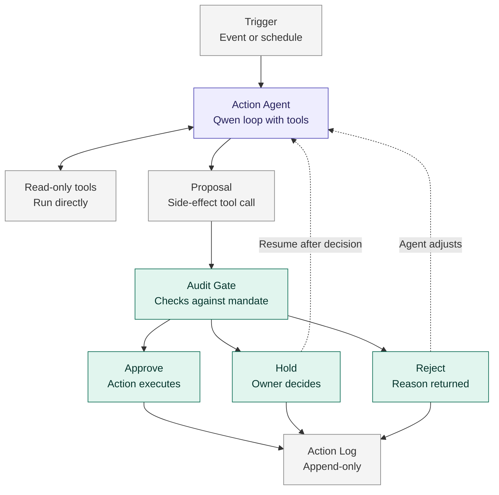

# Helios — Platform Status

Written for a cold reader by session `p5-verify`, 2026-10-15. Every claim below was
observed in tool output during this session; where it was not, it is marked.

Helios is a platform on which a coding agent (Qwen) builds *agentic financial
applications* from a one-sentence description. Two claims carry the whole architecture.
**The model proposes, code decides**: an action agent may ask for anything, but what it
gets is bounded by policy written as data and enforced by deterministic code that fails
closed — and the policy is enforced by a separate package the app cannot modify. **Facts
are not claims**: every value a rule depends on is resolved from a trusted `FactSource`
the agent does not control, so "pay no more than the invoice amount" means the recorded
amount, never the amount the agent asserts. Both claims are demonstrable: an owner who
*approves* a payment to a supplier whose banking details just changed still has that
payment refused, because the control does not depend on the human noticing or on the
agent behaving.

---

## Component diagram

Verbatim from `specs/architecture-mermaid.md` §"Mermaid Component Diagram" (ids
`D1..D5, A, B, S1..S4, Q` preserved):



### Agent flow inside an application

Verbatim from `specs/architecture-mermaid.md` §"Mermaid Agent Flow":



---

## Reading the test counts

Two independent branch states were measured this session, and they differ because
sessions had not merged when the counts were taken:

- `worktree-p0-foundation` @ `9695b95`, cold-cloned to `/tmp/helios-pre`:
  `scripts/bootstrap-venv.sh` then `scripts/test-all.sh` → **`all 7 suites green: 803 passed`**
  (agent-integration 136, audit-agent-builder 81, deployment 96, financial-tools 367,
  helios-collect 74, invoice-payer 41, checks 8).
- `worktree-p3-builder` @ `c742d0b`, cold-cloned to `/tmp/helios-t4`: 6 suites,
  action-agent-builder 36, audit-agent-builder 79, agent-integration 123,
  financial-tools 86, app-builder 407, helios-collect 74 → **805 passed**.

Counts below are taken from the branch that owns that box. `action-agent-builder` has no
`tests/` suite on the p0 branch and 36 on the p3 branch; `financial-tools` has 367 on p0
and 86 on p3, because p1-tools and p0-foundation both imported the teammates' tool
families and those imports conflict (see Open items).

Baseline before any of this: 378 passed across five suites (`HANDOFF.md` §4), reproduced
exactly by this session.

---

### Qwen Coding Agent

- **Implemented:** the on-ramp a coding agent reads first — `entry-point/SKILL.md`
  (orientation, the three properties that decide whether an app is any good, critical
  warnings, competition non-negotiables) and `entry-point/BUILD.md` (the 8-step
  procedure). Plus `references/{platform-status,financial-tools,agent-loop}.md`, the
  worked example `examples/invoice-payer/`, and the interim validator
  `checks/check_app.py`.
- **Where:** `entry-point/`
- **Run:** `read entry-point/SKILL.md, then .venv/bin/python entry-point/checks/check_app.py apps/helios-collect`
- **Tests:** 8 (`entry-point/checks/tests`, on the p0 branch)
- **Gaps:** `QWEN.md` at the repo root — the file section A tells a session to read first
  — **does not exist** on any branch observed this session. Qwen Code CLI setup is not
  documented anywhere; `qwen_agent` is declared as an optional extra
  (`audit-agent-builder/pyproject.toml:19`) but is **not installed** by
  `bootstrap-venv.sh`, so the model-driven path is unexercised. Everything demos offline
  against `ScriptedDriver`.

### Financial Tools Interface + SDK (D1)

- **Implemented:** `fin_tools` — a tool registry with side-effect flags, an in-process
  transport (`InProcessToolClient`) and an HTTP transport (`HttpToolClient` +
  `ToolServer` on stdlib `http.server`, endpoints `GET /tools`, `POST /call`), plus
  `toolkit_bridge` which adapts `fin_tools`' flat `{name: "type"}` schemas to
  `agent_toolkit`'s JSON Schema shape.
- **Where:** `platform/financial-tools/`
- **Run:** `cd platform/financial-tools && .venv/bin/python -m pytest tests`
- **Tests:** 367 (p0 branch) / 86 (p3 branch) — see "Reading the test counts"
- **Gaps:** on the p0 branch the catalog is 12 tools in 5 families (payments, email,
  spreadsheet, graph, simulation). The teammates' families — `email_tool`,
  `payments_collect`, `helios_forecast`, `spreadsheets`, and a market-data family over
  public rate sources — were imported **twice**, independently, by p0-foundation and
  p1-tools, and the two imports conflict across 26 files. **No persistence layer**: all
  state is in-memory in a `World` dataclass, so nothing survives a restart.

### Application Builder (D2)

- **Implemented:** `app_builder` — a 16-question intake (`helios-app questions`),
  `spec-from-intake` to produce `helios-app.yaml`, a scaffolder (`helios-app new`) that
  writes the app skeleton from a spec, a validator (`helios-app validate`), and
  `agent-toolkit validate --audit` cross-checking the action and audit manifests against
  each other.
- **Where:** `platform/app-builder/src/app_builder/{cli,intake,spec,schema,scaffold,validate,stacks,deployment}.py`
- **Run:** `.venv/bin/helios-app validate apps/helios-expense-approver`
- **Tests:** 407 (p3 branch)
- **Gaps:** proven broken in the surprise-task rehearsal. The scaffolder emits
  `mandate.allowed_tools: []`, which its own validator rejects as "must be a non-empty
  list" — **every freshly scaffolded app fails validation out of the box.** It also marks
  a tool named `reimbursements_send` as `side_effect: false`, generates empty
  `input_schema.properties: {}` stubs, and leaves `GATED_TOOLS = []` in the generated
  test file so control tests skip silently. The spec's `tools:` format (plain string
  names, not objects) is undocumented; the rehearsal agent had to read another app's YAML
  to discover it. `BUILD.md:129` claims 23 files are generated; 20 were written.

### Action Agent Builder (D3)

- **Implemented:** the action side — `ToolDefinition` contract, mock tools, store,
  action manifests, an append-only action log, and the hold queue.
- **Where:** `platform/action-agent-builder/src/agent_toolkit/`
- **Run:** `cd platform/action-agent-builder && .venv/bin/python -m pytest tests`
- **Tests:** 36 (p3 branch); no `tests/` suite on the p0 branch
- **Gaps:** its in-process `AuditGate.MandateLimits` accepts only four
  receivables-shaped keys, so a payables app cannot express its policy there at all. The
  `agent-toolkit = agent_toolkit.cli:main` entry point was removed because `cli.py` did
  not exist; p3 added `cli.py` (`inspect`, `validate`, `demo`) but the entry point had
  not returned in the state observed.

### Audit Agent Builder (D4)

- **Implemented:** the standalone auditor — declarative rules from a YAML manifest,
  HMAC-SHA256-signed scoped single-use grants, trusted `FactSource` resolution, a
  hash-chained evidence log, and fail-closed adjudication (`approve` / `hold` / `reject`).
- **Where:** `platform/audit-agent-builder/src/audit_agent/`
- **Run:** `cd platform/audit-agent-builder && PYTHONPATH=src .venv/bin/python -m pytest tests`
- **Tests:** 81 (p0 branch) / 79 (p3 branch)
- **Gaps:** `auth_code` was missing from `REDACTED_KEYS`, so a real payment credential
  reached the audit log in full; p0-foundation fixed this (commit `e6e8bb1`) and
  `auth_code` / `authorization_code` are now present at
  `src/audit_agent/contracts.py:73-74`. Holds are in-memory only and
  `InMemoryReplayGuard` is single-process, so both are lost on restart.

### The seam: `agent-integration`

A note under the Agent Toolkit subgraph, because it is the only directory in the repo
allowed to import both D3 and D4 — and the two never import each other, since the audit
agent is only trustworthy because the app it audits cannot modify it.

- **Implemented:** `ToolContractView` (closes the duck-typing trap where a gated tool
  would register as `side_effect=False` and be handed to the model ungated),
  `manifest_gen` (derives the audit YAML from the action side's real tool definitions so
  the names cannot drift), `AuditBridge` (authorize a task, then adjudicate every side
  effect), `GatedAgentRuntime` (the gated loop: the auditor narrows the tool list *before*
  the model sees it, read-only calls run directly, every side effect becomes a `Proposal`
  adjudicated first, and on `allow` the auditor's `granted_arguments` execute — never the
  model's originals), `ScriptedDriver` and `ModelDriver`, and a CLI
  (`demo`, `doctor`, `run`, `inspect`, `manifest`, `selfcheck`).
- **Where:** `platform/agent-integration/src/agent_integration/`
- **Run:** `.venv/bin/python -m agent_integration.cli selfcheck` → exit 0, `seam check: OK`
- **Tests:** 136 (p0 branch) / 123 (p3 branch)
- **Gaps:** `ModelDriver` targeted GLM-5.3 on `bigmodel.cn`, contradicting the
  competition rule that Qwen is the only permitted model; both p0-foundation (commit
  `72829c1`) and this session migrated it to Qwen via DashScope OpenAI-compatible mode
  concurrently — see Open items. `doctor` reads `os.environ` only and nothing loads
  `.env`, yet its failure text says to edit `.env`; following that advice leaves it still
  failing (reproduced: exit 1 with a populated `.env`).

### Validation + Deployment (D5)

- **Implemented:** the deployment engine imported from the Mac-mini build —
  `helios.yaml` + ASGI entry + `GET /health` as the contract, docker-py control plane,
  nginx ingress on a shared network, per-tenant isolation, an audit sidecar container
  holding the execution secret, three golden images (`helios-app-base`, `helios-auditor`,
  `helios-core`), a Redis event bus, and a `helios` CLI.
- **Where:** `platform/deployment/{engine,cli,sdk,images,bootstrap.sh,test-deploy.sh}`
- **Run:** `cd platform/deployment && ./bootstrap.sh && helios deploy examples/sample-app --tenant demo`
- **Tests:** 96 (`platform/deployment/tests`, p0 branch)
- **Gaps:** verified working end to end this session (see "How to demo"), but
  **`helios doctor` does not exist** — the CLI accepts only `deploy`
  (`cli/helios.py:42`), identical to the original Mac-mini build, and `helios doctor`
  exits 2 with `invalid choice: 'doctor'`. No app has a `helios.yaml` yet, so no real app
  has adopted the contract. Docker Hub (`registry-1.docker.io`) is unreachable from this
  machine; the base images had to be pulled via a third-party mirror and retagged.

### Application A — Customer Payment App (payables)

- **Implemented:** the reference shape only. `examples/invoice-payer` is a complete
  running app built from one sentence, and its scripted owner *confirms a payment to a
  supplier whose banking details just changed* — the payment still does not go out.
- **Where:** `entry-point/examples/invoice-payer/`
- **Run:** `.venv/bin/python entry-point/examples/invoice-payer/app.py`
- **Tests:** 41 (p0 branch)
- **Gaps:** **`apps/helios-payables` does not exist on any branch.** p4-payables has 0
  commits past the base. This box is unimplemented as a deployed application.

### Application B — Invoice Management App (collect)

- **Implemented:** `apps/helios-collect` — invoices and customers as JSON fixtures, a
  `FactSource` reading the app's own data, action and audit manifests, and control tests
  asserting each gate fires.
- **Where:** `apps/helios-collect/{app,book,config,facts,tools}.py`, `agents/`, `data/`, `helios-app.yaml`
- **Run:** `.venv/bin/python entry-point/checks/check_app.py apps/helios-collect` → 0 errors, 3 warnings, exit 0
- **Tests:** 74
- **Gaps:** no `helios.yaml`, so it has not adopted the deployment contract and cannot be
  deployed by the engine. No UI — every app is CLI-only, so a held action pauses the
  agent invisibly. Cash Planner does not exist on any branch.

### Application — Expense Approver (the fourth demo)

- **Implemented:** built during this session's surprise-task rehearsal from the sentence
  "Build an app that approves employee expense claims against a monthly budget per
  department and reimburses the approved ones, using Helios", using only
  `entry-point/SKILL.md` and `BUILD.md`. Reached validator 0 errors and all four
  required controls passing: budget ceiling hold, duplicate claim refused, reimbursement
  requires owner intent, lying agent caught.
- **Where:** `apps/helios-expense-approver/` — **exists only in the throwaway clone
  `/tmp/helios-t4`, not committed.** The rehearsal was run in a clone deliberately, so a
  partially-scaffolded fourth app would not land on the verification branch.
- **Run:** `.venv/bin/helios-app validate apps/helios-expense-approver` → 0 errors
- **Tests:** 16 (`tests/test_controls.py`, all passing)
- **Gaps:** could not be deployed through the documented path — `cli/helios.py deploy`
  does not exist and `helios-app` has no `deploy` subcommand. `/health` returned 200 only
  after manually installing `fastapi`/`uvicorn`, which `bootstrap-venv.sh` omits even
  though the generated `server.py` imports them. Nine defects recorded in
  `docs/sessions/p5-verify/`; the two blockers are the undocumented spec `tools:` format
  and the missing deploy CLI.

### Shared State & Knowledge Graph (S1)

- **Implemented:** `graph.upsert_verified`, `graph.add_observation` and `graph.read` as
  `fin_tools` prototypes, with the verified/observation distinction enforced —
  `add_observation` raises on a verified node.
- **Where:** `platform/financial-tools/fin_tools/knowledge_graph.py`
- **Run:** `.venv/bin/python -c "import fin_tools; print(len(fin_tools.build_world().registry.list()))"`
- **Tests:** included in the `financial-tools` count (367 / 86)
- **Gaps:** not a service — in-memory, single-process, no network, no database. Cross-app
  coordination, the only architecture claim currently undemonstrable, still cannot be
  shown between two deployed apps. Note the real method names are `upsert_verified` /
  `add_observation`; there is no `publish_verified`.

### Managed Financial Tools API (S2)

- **Implemented:** the HTTP tool service — `ToolServer` exposing `GET /tools` and
  `POST /call`, and `HttpToolClient` as its transport, so tools can be served centrally
  rather than imported.
- **Where:** `platform/financial-tools/fin_tools/service.py`
- **Run:** `.venv/bin/python -m fin_tools.service` (stdlib `http.server`)
- **Tests:** included in the `financial-tools` count
- **Gaps:** not deployed as a shared service; no app calls it over HTTP in the demos.
  Money is simulated end to end (decision B4) — every prototype touches no network, no
  database and no real money.

### Intent & Trust Service (S3)

- **Implemented:** intent capture, confirmation and revocation with single-use
  `auth_code` credentials, deliberately **excluded** from agent access
  (`toolkit_bridge.py:124`) so an agent cannot confirm its own intent. `payments.send`
  distinguishes an absent `auth_code` ("missing verified intent auth code") from a
  present-but-invalid one ("unknown auth code", or "amount differs from confirmed
  intent").
- **Where:** `platform/financial-tools/fin_tools/intent_verification.py`
- **Run:** covered by `financial-tools` tests
- **Tests:** included in the `financial-tools` count
- **Gaps:** not a service — a prototype inside `fin_tools`. The `auth_code` leak into the
  audit log was fixed in `audit_agent` but the two-layer split (gate checks presence, tool
  checks validity) means a test asserting only a verdict can pass while no money moves.

### Shared Events & Updates (S4)

- **Implemented:** a real Redis pub/sub event bus between containers on the tenant
  network, reached through the deployed app. **Verified this session**:
  `POST /demo/announce-event` → `{"status":"published","channel":"demo:events"}` and
  `GET /events` → `{"events":[{"event":"receivable.rescheduled","data":{"invoice":"INV-0042","new_due":"2026-10-28"},"app":"sample-collect"}]}`.
- **Where:** `platform/deployment/engine/orchestrator.py` (the `helios-redis-<tenant>` container), consumed via `sdk/helios_sdk/`
- **Run:** `curl -X POST http://localhost/apps/sample-collect-demo/demo/announce-event`
- **Tests:** included in the 96 `platform/deployment` tests
- **Gaps:** only the sample app publishes. No real app subscribes to another app's
  updates, so cross-app coordination is demonstrated at the bus level but not between two
  flagship applications.

---

## How to demo in 10 minutes

All commands verified this session against a cold clone at `/tmp/helios-pre`, on
`worktree-p0-foundation` @ `9695b95`.

```bash
# 1. Cold start: nothing but the repo and Python 3.13.
git clone <repo> /tmp/helios-cold && cd /tmp/helios-cold && git checkout chloe-dev
scripts/bootstrap-venv.sh          # ends: ok agent_toolkit / audit_agent /
                                   #       agent_integration / fin_tools / engine
scripts/test-all.sh                # ends: all 7 suites green: 803 passed

# 2. Platform up (needs a Docker provider; see the mirror caveat below).
cd platform/deployment && ./bootstrap.sh
curl http://127.0.0.1:8100/health  # {"status":"ok","service":"helios-deployment-engine"}

# 3. Deploy, and prove the health contract.
helios deploy examples/sample-app --tenant demo   # {"status":"deployed", ...}
curl -i http://localhost/apps/sample-collect-demo/health
# HTTP/1.1 200 OK
# {"status":"ok","app":"sample-collect","tenant":"demo"}
```

**The four judge moments.**

1. *Disputed invoice refused* — `apps/helios-collect`, invoice `INV-1006` / `INV-1009`:
   the auditor denies on a fact read from the app's own data, not from the agent's
   argument.
2. *Changed payee refused despite approval* — `examples/invoice-payer`, `INV-1003`. The
   scripted owner explicitly **confirms** the payment to a supplier whose banking details
   just changed, and it still does not go out. This is the strongest
   architecture-defence moment on the platform: the control does not depend on the human
   noticing, or on the agent behaving.
3. *Duplicate held by the trusted sidecar* — verified this session end to end:
   ```
   POST /demo/collect-payment → {"status":"executed","audit_id":"9259024f620b", ...}
   POST /demo/collect-payment → {"status":"held_for_review",
     "reason":"possible duplicate invoice/payment within 120s window"}
   ```
   The sidecar's `/audit-log` records **both** decisions.
4. *Shortfall known weeks ahead, with the public rate cited* — **not demonstrable.**
   Cash Planner does not exist on any branch, and the forecast/market tool families that
   would cite a public rate are the ones caught in the p0/p1 import conflict.

**Mirror caveat for anyone repeating this.** `registry-1.docker.io` times out from this
machine, so `python:3.12-slim-bookworm`, `nginx:alpine` and `redis:7-alpine` were pulled
via `dockerproxy.net` and retagged to their canonical names. `helios-auditor` is the
trusted sidecar holding the execution secret and is built `FROM python:3.12-slim-bookworm`,
which puts an unverified third-party base inside the platform's trust boundary. For a
judged demo, pull from a registry the team controls or verify the digest
(`sha256:34386ef0cb081344d7ec1c103ba398e6e9f64e9ab3a1509accc92a4e24a07258`).

---

## Open items — owner decisions needed

1. **The upstream branches conflict with each other and must be reconciled before any
   merge.** p0-foundation and p1-tools independently imported the same teammate tool
   families into `platform/financial-tools/`, and p0 and p2 both created
   `platform/deployment/`. A trial merge in a throwaway clone hit 26 conflicted files for
   p1 alone, plus `scripts/bootstrap-venv.sh` and `scripts/test-all.sh` conflicting across
   all four. Which import wins, and who rebases?
2. **Qwen-vs-GLM is now migrated twice, concurrently.** p0-foundation landed commit
   `72829c1` and this session landed an equivalent migration, then reverted it
   (`2e66fe1`) once p0's was found to be strictly better — p0 verified that qwen3
   hybrid-thinking models refuse a *non-streaming* request while thinking is on, and
   sends `enable_thinking: false` explicitly, whereas this session's version defaulted it
   on alongside `stream: false` and would have failed at runtime. Take p0's. Confirm no
   second migration survives the merge.
3. **`helios doctor` does not exist.** Decision B1 says apps adopt the engine and the
   engine is adapted where the app side cannot be, so either add a `doctor` subcommand to
   `platform/deployment/cli/helios.py` or drop it from the runbook.
4. **The scaffolder emits an app its own validator rejects** (`mandate.allowed_tools: []`),
   and marks a `*_send` tool as having no side effect. This is the surprise-task path a
   judge will walk. Who fixes `platform/app-builder/`?
5. **`apps/helios-payables` and Cash Planner do not exist** (p4-payables has 0 commits).
   Judge moment 4 is undemonstrable without Cash Planner. Is the demo scope reduced to two
   apps, or is a flagship still coming?
6. **`bootstrap-venv.sh` omits `fastapi`/`uvicorn`** although the generated `server.py`
   imports them, so a scaffolded app cannot boot from a cold clone.
7. **No app has a `helios.yaml`**, so no real application has adopted the deployment
   contract — only `examples/sample-app` deploys.
8. **The two audit gates still overlap** and nobody has resolved which is authoritative.
   `AGENTS.md` requires team sign-off; this session deliberately did not resolve it.
9. **`QWEN.md` does not exist**, though section A of the session brief tells every agent
   to read it first.
10. **Merge is currently blocked**: the main checkout is dirty with untracked
    `.env.example` and `.qwen/`, which section H step 1 does not permit, so this branch
    was not landed.
