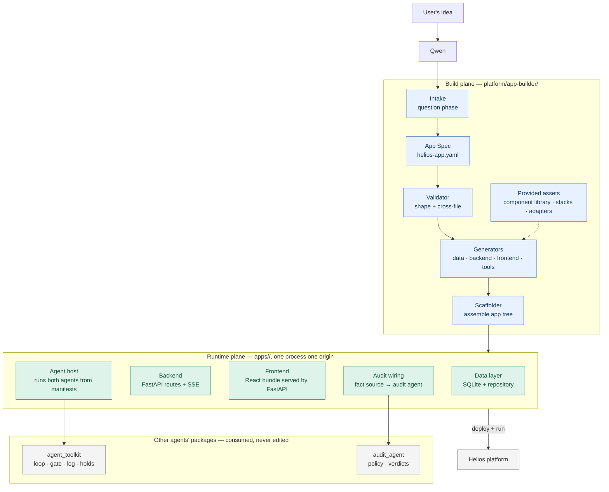

# Application Builder — Architecture and Functionality

High-level plan. Stack: FastAPI + SQLite (SQLAlchemy) + Vite-built React, with a
shared component library (`specs/tech-stack.md`). Design detail:
`specs/app-builder.md`.

Nothing coded yet.

---

## 1. The architecture in one distinction

The Application Builder spans **two planes**, and keeping them separate is the
whole design:

- **Build plane** — what Qwen uses, once, to create an app. Lives in
  `platform/app-builder/`. Runs at generation time, then is done.
- **Runtime plane** — what a generated app contains and runs forever after. Lives
  in `apps/<name>/`. No dependency on the build plane at runtime.

This matters because the competition asks whether a generated app "deploys and
runs on the platform" — which is a runtime claim. An app that needs the builder
present to run is not deployed, it's still being built.



---

## 2. Build plane — components

Five components, in pipeline order.

**Intake (question phase).** The fixed questions Qwen works through with the user.
Turns "build me an invoicing app" into concrete answers about data, agents, tools,
pages — and, critically, **what already exists**. The integration questions come
first, because whether something already exists changes every later answer.

**App Spec (`helios-app.yaml`).** One YAML file describing an application
completely enough to generate it. The single artifact the two planes share: the
build plane produces it, the runtime plane is generated from it, and it ships with
the app so anyone can see what it was built to be.

**Validator.** Shape checks, plus the cross-file checks one file cannot express —
above all that every tool an action agent may call is declared by the audit agent.
Its messages are the feedback loop back to Qwen: specific, actionable, all reported
at once. Fails closed.

**Generators.** Four, one per runtime layer — data, backend, frontend, tools. Each
reads the spec and emits code from templates. They share the provided assets
(component library, stack definitions, integration adapters) rather than each
inventing conventions.

**Scaffolder.** Assembles generator output into an app tree. Idempotent, and never
overwrites an existing file silently. Where the spec says something already exists,
it skips generating a competitor and adapts to what's there.

---

## 3. Provided assets

Three things the builders consume rather than generate.

**Component library.** Prebuilt React components Qwen mixes, matches, and modifies:
page shell, nav, data table, record card, stat tile, form field, button, badge,
modal, empty/error states, and the **held-action card**. Each handles its own
loading, empty, and error states internally. Design tokens (colour, spacing, type)
sit underneath, so restyling an app — or adopting an existing system's look — means
changing tokens, not components.

This is the mitigation for the one real cost of choosing React: Qwen assembles
known-good parts instead of inventing markup that has to be right first time. It is
also what makes generated apps look credible, which the 50% pitch weighting rewards.

**Stack definitions (`stacks.yaml`).** Named, pinned stacks plus the default. "If
not specified, use X" is a resolved default, not an omission — an undecided app
still builds.

**Integration adapters.** The glue between a generated app and the two agent
packages. Three, and they carry most of the architectural risk:

- **Fact source adapter** — bridges the app's own database to the audit runtime's
  `FactSource` protocol.
- **Agent host** — starts both agents from their manifests and exposes runs,
  events, and holds to the backend.
- **Graph wiring** — publish/subscribe call sites for the shared knowledge graph,
  against a stub until that service is settled.

The packages are consumed **as data and through their public entrypoints only**.
Manifests are read, never imported; each generated app runs its own copy of the
shared runtime.

---

## 4. Runtime plane — inside every generated app

**One process, one origin, one port.** FastAPI serves the built React bundle, so
the approval flow is a same-origin call. No CORS, no second deployment artifact, no
cross-boundary state for the most important interaction in the product.

| Component | Responsibility |
|---|---|
| **Data layer** | SQLite per app, SQLAlchemy models from the spec's entities, typed repository. Money is `Decimal`, never float |
| **Backend** | FastAPI: entity CRUD, agent-run endpoints, holds endpoints, SSE for live activity |
| **Frontend** | React bundle; pages composed from the component library per the spec's patterns |
| **Agent host** | Runs action and audit agents from their manifests; manages run state |
| **Audit wiring** | Supplies the fact source; routes proposals to the audit gate |
| **Config** | Env-var secrets, owner identity, data paths |

**Owner identity** is a hardcoded stub for prototype. It must exist, because the
approval flow needs to know who is deciding — but it does not need to be real yet.

---

## 5. Functionality flows

### Flow A — Idea to running app (build time)

```
User describes an app
   ↓
Qwen works the question phase
   ↓  ── discovers what already exists FIRST
App spec written (helios-app.yaml)
   ↓
Validate ── shape, then cross-file against both manifests
   ↓  ── problems returned to Qwen, all at once
   ↑  └── revise and re-validate (the normal loop)
   ↓
Generators run: data → backend → frontend → tools
   ↓
Scaffolder assembles apps/<name>/
   ↓
One command: migrate · seed · build frontend · serve
   ↓
Running app, with demo data, ready to demo
```

The loop between validate and revise is the intended path, not an error case. Qwen
is expected to get it wrong and be told precisely what to fix.

### Flow B — Inside a running app (the differentiator)

This is the flow that makes Helios distinct from any other app generator. The
design principle throughout: **the model proposes, code decides.**

```
Trigger ── button, schedule, or incoming event
   ↓
Action agent runs (Qwen loop, from its manifest)
   ↓
Read-only tool call ──────────────→ executes directly
   ↓
Side-effect call
   ↓
Becomes a PROPOSAL — does not execute
   ↓
Audit gate checks against the mandate
   │  facts come from the app's own database via the
   │  fact source adapter, never from the agent's claims
   ↓
   ├── APPROVE → action executes
   ├── REJECT  → reason returns to the agent, which adjusts
   └── HOLD    → agent pauses, state persisted
                    ↓
              Surfaced in the UI as a held-action card:
              what was proposed, which rule held it,
              approve / reject
                    ↓
              Owner decides
                    ↓
              Agent resumes from exactly where it stopped
                    ↓
              Approval applies to that one action only
   ↓
Every step — call, proposal, verdict, result — in the
append-only action log
```

Two architectural notes on this flow:

**The fact source is load-bearing and fails silently.** The audit runtime resolves
every fact-bound rule — invoice amounts, contact counts, changed payment details —
through a `FactSource` the app must supply. Without one, facts come back empty and
**every fact-bound rule fails closed**: the audit agent refuses everything,
including actions comfortably inside the mandate. That presents as a policy bug,
not a wiring bug. Mitigation: the adapter is a generated component, and the
validator fails the build if an audit manifest declares fact-bound rules and no
fact source is wired.

**Hold persistence already exists.** `agent_toolkit` writes holds to
`.runs/<run_id>/holds/<proposal_id>.json` with list/load/delete. The approval API
sits on top of it — no new state management, and resumption is already
implemented. Good news: Flow B is mostly wiring and UI, not new machinery.

### Flow C — Fitting an existing system (the surprise task path)

```
Question phase discovers an existing system
   ↓
Recorded in the spec's `existing` section
   ↓
stack.match_existing  → adopt its stack, generate no competitor
data.integration      → read its data, create no duplicate schema
ui.align_with         → re-token the component library to its look
   ↓
Generate ONLY what is missing
   ↓
Validator confirms the spec's integration claims are populated
   ↓
An app that looks like it always belonged there
```

A generated app is **Helios-compatible, not Helios-identical**. Compatibility
means: declares its data, agents, tools, and graph interactions in the spec; runs
the shared agent runtime; passes the validator. It does not mean it resembles the
other apps.

This flow is what the surprise task tests — judges give a new requirement after
code lock and check whether an AI-built app can be made compatible and run through
the platform.

---

## 6. Boundaries and risks

**The action agent loop now exists.** It is `platform/agent-integration/`:
`runtime.GatedAgentRuntime` (authorize → propose → adjudicate → execute/hold/deny,
with resumable holds) and `model_driver.ModelDriver` (Qwen over DashScope's
OpenAI-compatible endpoint, stdlib `urllib`). `build_integration()` assembles it in
one call, and the CLI provides `demo`, `doctor`, `run`, `inspect`, `manifest`,
`selfcheck`. `agent_toolkit` itself still has no loop and no `cli.py` — the
unused `qwen-agent` dependency declaration and the `cli:main` script entry that
pointed at a non-existent module were both removed, so `pip install -e` now
succeeds; P3 writes that CLI.

*Consequence:* Flow B can be completed end-to-end. The agent host no longer needs
to wait for a loop to land.
*Note:* define the host against `build_integration()` / the `Driver` protocol
rather than re-implementing a loop. The loop is not built on Qwen-Agent — no file
in the repo imports `qwen_agent` except one lazy optional import behind
`audit-agent-builder`'s `advisory` extra.

**Unsettled terminology.** `platform/agent-toolkit/` became
`platform/action-agent-builder/`, but the Python package is still `agent_toolkit`
and its README still says "Agent Toolkit". Templates should reference the package
name, not the directory path. There is also a third package now,
`platform/agent-integration/` (`agent_integration`), which is the only one allowed
to import both builders — templates must not imply the two builders import each
other.

**Two languages in one generated app.** The component library is the mitigation;
its completeness is what determines how much TypeScript Qwen has to invent. Build
it early, not late.

**Scope discipline.** Flows A and B are the prototype. Flow C is the differentiator
for the surprise task and can follow. A working Flow B demo beats a polished
component library.

---

## 7. Sequencing

Vertical slices, each ending in something runnable.

| Phase | Delivers | Depends on other agents? |
|---|---|---|
| **0 — Contract** | Spec models, both validators, defaults, `stacks.yaml` | No — manifests read as data |
| **1 — Thinnest running app** | Scaffolder + generators for data, backend, frontend. A spec produces a running app with seeded data and a visible table. **No agents** | No |
| **2 — The differentiator** | Agent host, fact source adapter, tools layer, holds endpoints, held-action card. Flow B end-to-end | **Yes** — needs the agent loop |
| **3 — Component library depth** | Full component set, six patterns, typed API client | No |
| **4 — Adaptability** | Flow C: `existing` paths, token-based `align_with`, graph wiring | No |
| **5 — Reference apps** | Collect generated end-to-end, then the three flagship apps | No |

Phase 1 deliberately excludes everything agent-related so the stack choice gets
proven while the loop is still being written.

---

## 8. Not doing

Financial tool implementations beyond the contract · agent runtime, interception,
gate, log, holds · audit policy and mandate rules · Build & Audit Agent Engine and
Automatic Deployment Engine · shared services themselves (graph wiring targets a
stub) · real authentication · production hosting and the deployment artifact
format.
