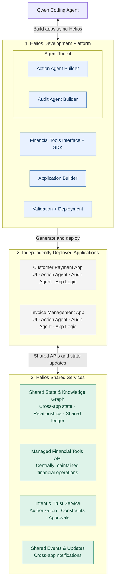
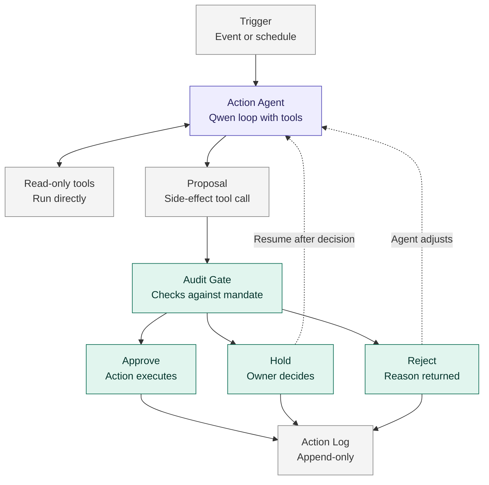

## Architecture Overview

Helios is a platform that enables Qwen to generate, validate, and deploy agentic financial applications using reusable development tools and financial capabilities.

The architecture is divided into three parts:

### 1. Helios Development Platform

Provides the tools Qwen uses to create applications.

- **Financial Tools Interface + SDK:** Exposes reusable financial capabilities through developer-facing interfaces. Every tool follows a shared contract that declares whether it has side effects.
- **Application Builder:** Provides app specifications, templates, and integration tooling.
- **Agent Toolkit:** Groups the agent frameworks packaged into generated applications:
  - **Action Agent Builder:** A framework for creating agents that perform financial workflows.
  - **Audit Agent Builder:** A framework for creating agents that monitor and review those workflows.
- **Agent Integration:** The seam between the two builders — `platform/agent-integration/`. This is a real, running component, not a planned one: it is the only package in the repo allowed to import both, and it holds the gated agent loop, the audit bridge, the adapters that close the two contracts' shape gaps, the manifest generator, the model driver and the CLI. The two builders never import each other, which is what keeps the auditor trustworthy — an app cannot modify the code that audits it.
- **Deployment Engine:** `platform/deployment/`. The deployment contract every app adopts: a `helios.yaml` manifest, an ASGI entry point and `GET /health`. Builds app bundles on golden base images, smoke-tests them in a sandbox, attaches a per-app audit sidecar, and routes them through nginx. Drives the Docker Engine API via docker-py.
- **Validation + Deployment:** `helios-app validate` (`platform/app-builder`) checks a generated application against its own manifests and code — action tools ⊆ audit tools, side-effect flags agree in both files, every fact a rule binds is produced — and `platform/deployment/cli/helios.py deploy` ships it. Every problem is reported at once, each naming the field and what to write instead, and the deploy response carries the build or smoke-test log, so a coding agent can revise and redeploy.

### 2. Generated Applications

Each generated application is deployed separately and contains its own UI, business logic, action agents, and audit agents.

Agents execute within their respective applications rather than through a centralized Helios agent runtime.

Applications may use packaged SDK capabilities and connect to centrally hosted Helios services.

Three flagships exist, each built through the platform and deployable under one tenant at the same time:

- **Helios Collect** (`apps/helios-collect`) — chases overdue invoices, negotiates extensions within a capped authority, routes inbound money by configuration.
- **Helios Payables** (`apps/helios-payables`) — pays supplier bills that are due and affordable, reschedules the rest, holds duplicates and unusual amounts, refuses changed payee details, and asks the owner when a payment would leave payroll short according to the platform's forecaster.
- **Helios Cash Planner** (`apps/helios-cash-planner`) — forecasts thirteen weeks from how customers actually pay, warns weeks ahead, recommends one action per short week with the public reference rate cited. The forecast is a fact the agent cannot write.

Each app has one container plus a platform-owned audit sidecar; data lives on a named volume that survives redeploys.

### 3. Helios Shared Services

Services that remain available to applications after deployment.

- **Shared State & Knowledge Graph:** Maintains cross-application business context, relationships, and shared state. Verified records and agent observations are distinct, and an observation can never overwrite a verified node. Lives in the tenant core (below) and persists to SQLite on the tenant volume.
- **Managed Financial Tools API:** The **tenant core** — one `python -m fin_tools` container per tenant serving the whole tool registry (payments, collect, email, forecast, behavior, market, spreadsheet, sheets, graph) over HTTP, bearer-authenticated with the execution secret only the audit sidecars hold. Apps propose a named tool; the sidecar adjudicates and forwards; core executes and persists.
- **Intent & Trust Service:** Intent capture, confirmation and single-use auth codes bound to amount, currency and payee, signed with a secret that lives only in core. A bearer token authenticates a caller; it never authorises a payment.
- **Shared Events & Updates:** A Redis channel per tenant. An app publishes what it changed (`invoice.extension_agreed`, `bill.rescheduled`, ...) and others subscribe; the graph node is the record, the event is the notification.
- **Central evidence:** `GET /api/v1/tenants/<t>/logs` on the deployment engine returns every app's action log, hash-chained audit log and sidecar log, each chain verified.

### Agent Toolkit: How Action and Audit Agents Work

The Agent Toolkit provides a shared runtime that is packaged into each generated application. It separates what is the same for every agent from what is specific to each app.

**Runtime (maintained by Helios, identical in every app):**
- **Agent loop:** the model calls tools in a loop. It is an OpenAI-compatible tool-calling loop driven by Qwen over stdlib HTTP — **not** built on Qwen-Agent; no file in the repo imports `qwen_agent`. One tool call is parsed per turn.
- **Interception:** tool calls with side effects become proposals instead of executing. The driver returns a proposal and stops, so interception is structural rather than a hook into someone else's loop — that is what makes the gate unavoidable.
- **Audit gate:** the standalone audit agent checks each proposal against policy declared as data and returns approve, hold, or reject. It issues signed, scoped, time-boxed grants and resolves limits against trusted facts rather than the agent's own claims. (`agent_toolkit.audit.AuditGate` is legacy and not in the run path — see `specs/decisions.md`.)
- **Action log:** an append-only record of tool calls, proposals, decisions, and results. The audit side is hash-chained, so tampering or deletion is detectable.
- **Holds:** a held action pauses the agent; it resumes once the owner decides, and an approval applies only to the exact action that was held.

The loop, the interception and the bridge that reaches the auditor live in `platform/agent-integration/`, because that package is the only place allowed to import both builders. The two builders themselves stay independent: `action-agent-builder` supplies the tool contract, store and action log; `audit-agent-builder` supplies the standalone auditor.

**Agent manifest (generated by Qwen, specific to each app):**
- Instructions for the agent
- Which tools it may use
- Its mandate: limits and which actions need owner approval

Flow inside an application:

1. The action agent reads data with read-only tools as needed.
2. When it wants to take an action with a side effect, it produces a proposal.
3. The audit gate approves, holds, or rejects the proposal.
4. Approved actions execute. Held actions wait for the owner. Rejected actions return a reason so the agent can adjust.
5. Every step is written to the action log.

The design principle is that **the model proposes and code decides**. Agents cannot exceed their mandate, because the code that executes actions enforces it.

### Cross-App Coordination

Applications never call each other. Each works alone first; coordination is an added feature that flows only through the shared services:

1. Collect agrees a due-date extension, publishes a **verified** `invoice` node and emits `invoice.extension_agreed` on the tenant bus.
2. Cash Planner, subscribed to the bus, re-projects against the agreed date and publishes a **verified** `cashplan:<week>` warning if a week goes short.
3. Payables asks the platform's forecaster, as a fact inside its own gate, whether paying a bill now leaves payroll short, and holds the payment for the owner when it does.

The shared ledger in the tenant core preserves verified financial records, while the knowledge graph makes relationships and current context accessible across applications.

### Current Design Assumptions

- Qwen generates application code using Helios's development interfaces.
- Action and audit agents run within generated applications, using the Agent Toolkit runtime.
- App-specific agent behavior is defined in a manifest rather than custom agent code.
- The knowledge graph is centrally hosted by Helios.
- Financial capabilities are one registry, composed in-process for local runs and tests and served by the tenant core when deployed.
- Deployment is automated through the deployment engine; the coding agent drives it from the CLI and reads its exit codes.

These assumptions may evolve as the interfaces and implementation are defined.

### Mermaid Component Diagram

### Mermaid Agent Flow (inside an application)

