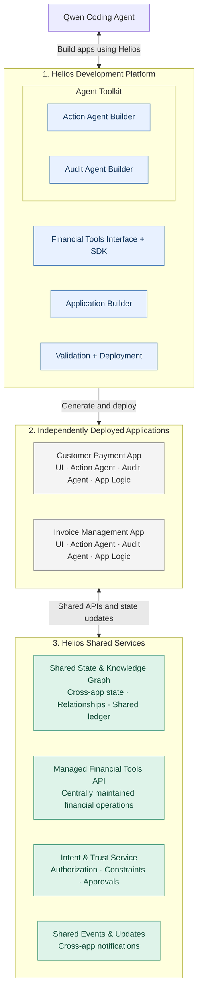

## Architecture Overview

Helios is a platform that enables Qwen to generate, validate, and deploy agentic financial applications using reusable development tools and financial capabilities.

The architecture is divided into three parts:

### 1. Helios Development Platform

Provides the tools Qwen uses to create applications.

- **Financial Tools Interface + SDK:** Exposes reusable financial capabilities through developer-facing interfaces.
- **Application Builder:** Provides app specifications, templates, and integration tooling.
- **Agent Toolkit:** Groups the agent frameworks packaged into generated applications:
  - **Action Agent Builder:** A framework for creating agents that perform financial workflows.
  - **Audit Agent Builder:** A framework for creating agents that monitor and review those workflows.
- **Validation + Deployment:** Checks generated applications and supports automated deployment, including revision feedback to Qwen.

### 2. Generated Applications

Each generated application is deployed separately and contains its own UI, business logic, action agents, and audit agents.

Agents execute within their respective applications rather than through a centralized Helios agent runtime.

Applications may use packaged SDK capabilities and connect to centrally hosted Helios services.

### 3. Helios Shared Services

Services that remain available to applications after deployment.

- **Shared State & Knowledge Graph:** Maintains cross-application business context, relationships, and shared state.
- **Managed Financial Tools API:** Provides centrally maintained financial operations and integrations.
- **Intent & Trust Service:** Supports permission checks, user-defined constraints, and approvals.
- **Shared Events & Updates:** Allows applications to react to changes originating from other applications.

### Cross-App Coordination

Applications maintain their own internal state but can publish relevant updates to Helios's shared services.

For example, a customer payment application may confirm a payment and publish the result. An invoice management application can then retrieve or receive the updated state and adjust its workflow.

The shared ledger is intended to preserve verified financial records, while the knowledge graph makes relationships and current context accessible across applications.

### Current Design Assumptions

- Qwen generates application code using Helios's development interfaces.
- Action and audit agents run within generated applications.
- The knowledge graph is centrally hosted by Helios.
- Financial capabilities may be provided through a combination of packaged libraries and managed APIs.
- Deployment is intended to be automated through Qwen and Helios's deployment tooling.

These assumptions may evolve as the interfaces and implementation are defined.

### Mermaid Component Diagram

