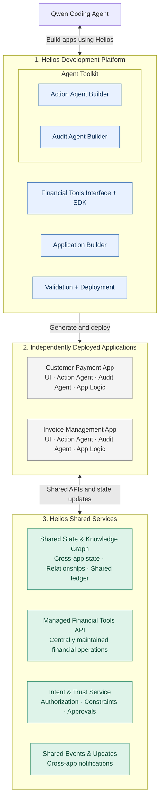
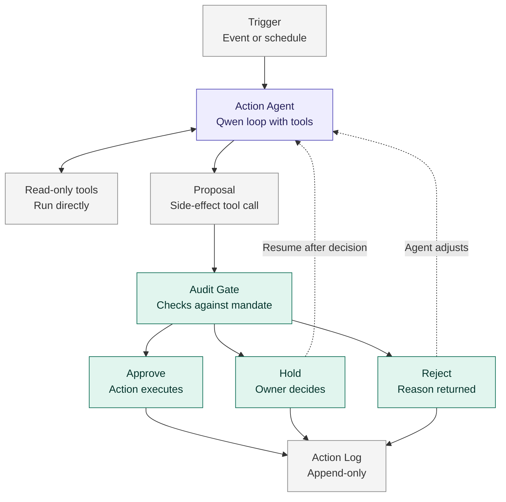

## Architecture Overview

Helios is a platform that enables Qwen to generate, validate, and deploy agentic financial applications using reusable development tools and financial capabilities.

The architecture is divided into three parts:

### 1. Helios Development Platform

Provides the tools Qwen uses to create applications.

- **Financial Tools Interface + SDK:** Exposes reusable financial capabilities through developer-facing interfaces. Every tool follows a shared contract that declares whether it has side effects.
- **Application Builder:** Provides app specifications, templates, and integration tooling.
- **Agent Toolkit:** Groups the agent frameworks packaged into generated applications:
  - **Action Agent Builder:** A framework for creating agents that perform financial workflows.
  - **Audit Agent Builder:** A framework for creating agents that monitor and review those workflows.
- **Agent Integration:** The seam between the two builders — `platform/agent-integration/`. This is a real, running component, not a planned one: it is the only package in the repo allowed to import both, and it holds the gated agent loop, the audit bridge, the adapters that close the two contracts' shape gaps, the manifest generator, the model driver and the CLI. The two builders never import each other, which is what keeps the auditor trustworthy — an app cannot modify the code that audits it.
- **Deployment Engine:** `platform/deployment/`. The deployment contract every app adopts: a `helios.yaml` manifest, an ASGI entry point and `GET /health`. Builds app bundles on golden base images, smoke-tests them in a sandbox, attaches a per-app audit sidecar, and routes them through nginx. Drives the Docker Engine API via docker-py.
- **Validation + Deployment:** Checks generated applications and supports automated deployment, including revision feedback to Qwen. `entry-point/checks/check_app.py` is the working stand-in for the app-builder validator that does not exist yet; the deployment engine above is what deploys.

### 2. Generated Applications

Each generated application is deployed separately and contains its own UI, business logic, action agents, and audit agents.

Agents execute within their respective applications rather than through a centralized Helios agent runtime.

Applications may use packaged SDK capabilities and connect to centrally hosted Helios services.

### 3. Helios Shared Services

Services that remain available to applications after deployment.

- **Shared State & Knowledge Graph:** Maintains cross-application business context, relationships, and shared state.
- **Managed Financial Tools API:** Provides centrally maintained financial operations and integrations.
- **Intent & Trust Service:** Supports permission checks, user-defined constraints, and approvals.
- **Shared Events & Updates:** Allows applications to react to changes originating from other applications.

### Agent Toolkit: How Action and Audit Agents Work

The Agent Toolkit provides a shared runtime that is packaged into each generated application. It separates what is the same for every agent from what is specific to each app.

**Runtime (maintained by Helios, identical in every app):**
- **Agent loop:** the model calls tools in a loop. It is an OpenAI-compatible tool-calling loop driven by Qwen over stdlib HTTP — **not** built on Qwen-Agent; no file in the repo imports `qwen_agent`. One tool call is parsed per turn.
- **Interception:** tool calls with side effects become proposals instead of executing. The driver returns a proposal and stops, so interception is structural rather than a hook into someone else's loop — that is what makes the gate unavoidable.
- **Audit gate:** the standalone audit agent checks each proposal against policy declared as data and returns approve, hold, or reject. It issues signed, scoped, time-boxed grants and resolves limits against trusted facts rather than the agent's own claims. (`agent_toolkit.audit.AuditGate` is legacy and not in the run path — see `specs/decisions.md`.)
- **Action log:** an append-only record of tool calls, proposals, decisions, and results. The audit side is hash-chained, so tampering or deletion is detectable.
- **Holds:** a held action pauses the agent; it resumes once the owner decides, and an approval applies only to the exact action that was held.

The loop, the interception and the bridge that reaches the auditor live in `platform/agent-integration/`, because that package is the only place allowed to import both builders. The two builders themselves stay independent: `action-agent-builder` supplies the tool contract, store and action log; `audit-agent-builder` supplies the standalone auditor.

**Agent manifest (generated by Qwen, specific to each app):**
- Instructions for the agent
- Which tools it may use
- Its mandate: limits and which actions need owner approval

Flow inside an application:

1. The action agent reads data with read-only tools as needed.
2. When it wants to take an action with a side effect, it produces a proposal.
3. The audit gate approves, holds, or rejects the proposal.
4. Approved actions execute. Held actions wait for the owner. Rejected actions return a reason so the agent can adjust.
5. Every step is written to the action log.

The design principle is that **the model proposes and code decides**. Agents cannot exceed their mandate, because the code that executes actions enforces it.

### Cross-App Coordination

Applications maintain their own internal state but can publish relevant updates to Helios's shared services.

For example, a customer payment application may confirm a payment and publish the result. An invoice management application can then retrieve or receive the updated state and adjust its workflow.

The shared ledger is intended to preserve verified financial records, while the knowledge graph makes relationships and current context accessible across applications.

### Current Design Assumptions

- Qwen generates application code using Helios's development interfaces.
- Action and audit agents run within generated applications, using the Agent Toolkit runtime.
- App-specific agent behavior is defined in a manifest rather than custom agent code.
- The knowledge graph is centrally hosted by Helios.
- Financial capabilities may be provided through a combination of packaged libraries and managed APIs.
- Deployment is intended to be automated through Qwen and Helios's deployment tooling.

These assumptions may evolve as the interfaces and implementation are defined.

### Mermaid Component Diagram

### Mermaid Agent Flow (inside an application)

