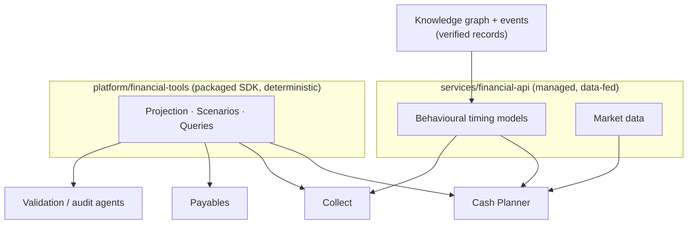

# Forecasting & Simulation Core

**Status:** Proposal — pending team review. Not yet reflected in `specs/decisions.md` or the architecture docs.

**Implementation status (2026-10-14):** the P0 core described in §3.1–3.4 is built and passing (36 tests) as the `helios_forecast` package at `platform/financial-tools/` — deterministic projection, seeded Monte Carlo, scenario deltas with `compare`, standard queries, and audit metadata. The P1 estimation math for §3.5 is also built there (`behavior.py`: empirical-Bayes shrinkage of payment-timing distributions and promise-keeping rates, with the §8 customer → segment → global → default fallback ladder); the managed service in `services/financial-api/` that learns these from cross-app events is not yet built. User guide: `platform/financial-tools/README.md`. The P2 market-data adapter for §3.6 is built at `services/financial-api/` (`financial_api/market.py`: Tushare LPR/SHIBOR client with token from the `TUSHARE_TOKEN` environment variable, engine-native `interest_flows`, offline constant-rate fallback; Tushare interface names recorded as unverified claims T5–T9 in `specs/forecasting-research-claims.md`). The P3 composed forecast endpoint is built (`financial_api/forecast.py` + `server.py`: behaviour enrichment over explicit business state, per-business stores, FastAPI service with `/health`, `PUT/GET /businesses/{id}`, `POST /forecast/{id}`; install with the `[server]` extra). The knowledge-graph source that would fill the same inputs is not yet built. The P4 surfacing is built in the SDK (`helios_forecast/tools.py`: 5 tool descriptors with GBNF-safe schemas + `call_tool` dispatcher; `validation.py`: `run_validation` declarative expectation suites; plus `calibration.py` conformal utilities and the optional `common_shock` correlated-stress factor on `simulate`).

## 1. Purpose

Define the reusable core that any Helios application needing decision simulation or numerical forecasting can build on, and the boundary between:

- **Platform capability** — general functionality every forecasting app would otherwise rebuild identically, provided once.
- **Application logic** — app-specific behaviour generated by Qwen for each application.

Serves commitments C03 (financial toolkit), C04 (AI financial intelligence), C05 (auditing loop), C08 (reusable foundation). Directly powers Helios Cash Planner; also serves Collect and Payables.

## 2. Boundary test

A capability belongs to the platform when any of these hold:

- Every forecasting app would reimplement it the same way (e.g., shortfall math).
- It must be deterministic and reproducible so audit agents can verify it.
- It depends on cross-app verified data or learned models no single app can own.

A capability belongs to the application when it encodes user intent, workflow, or natural language — the things that differ per business and per app, and that Qwen generates.

Rule of thumb: **if two forecasting apps would build it identically, it is platform; if they would build it differently, it is app logic.**

## 3. Platform core

### 3.1 Cash-flow projection engine (deterministic)

Input: opening balances per account, plus a timeline of expected flows. A flow carries an expected date (fixed or offset distribution), an amount (fixed or distributed), a direction, a certainty/probability, a recurrence rule for regular costs, and a source reference to the knowledge-graph record it came from.

Output: projected balances per account and in total, per day, over a horizon.

Pure function: same inputs produce the same outputs everywhere. This is what makes forecasts reproducible, loggable, and auditable.

### 3.2 Uncertainty representation and propagation

Simple, serializable structures — date offsets with probabilities, amount ranges — that an LLM can construct and inspect. The engine propagates uncertainty into percentile bands, shortfall probabilities, and expected totals. Monte Carlo or similar stays internal; the interface stays simple.

### 3.3 Scenario machinery (what-if)

A scenario is a baseline projection plus a structured delta: add, remove, shift, or resize flows; override a behaviour assumption. `compare(baseline, scenario)` returns a deterministic diff (e.g., first shortfall moves from day 12 to day 20; minimum balance falls by $4k).

This structured delta is the contract between app-level AI (which translates a user's natural-language question into a delta) and platform math (which evaluates it).

### 3.4 Standard forecast queries

- `balance_at(date)`
- `min_balance(window)`
- `first_shortfall(threshold)`
- `probability_below(threshold, window)`
- `expected_total(direction, window)`

These are the deterministic building blocks apps use for warnings and decisions.

### 3.5 Behavioural timing models (learned, managed service)

Per-customer and per-supplier payment behaviour learned from verified records and events across applications: timing vs due date, variance, promise-keeping rate, partial-payment frequency.

Served as parameters the projection engine consumes; apps may override them per scenario. Segment priors (industry/size defaults) cover cold start (§8).

Collect publishes the raw events these models learn from — the same app that benefits from the models feeds them.

### 3.6 Market data (managed service)

Public financial series — e.g., borrowing costs — which M2 commits to as "Helios data services." No such component exists in the current architecture. Proposal: serve it from `services/financial-api/` rather than adding a new component, unless the team prefers a dedicated data service (§9).

## 4. Application-specific logic (Qwen generates)

- Which questions matter and what thresholds mean to this user (plain-language rules → app logic).
- Natural language → scenario translation (the app's action agent builds deltas).
- Explanation, recommendations, and briefings (app AI over platform answers).
- Actions and cross-app orchestration (dispatched through other apps under Intent & Trust rules; forecasting apps never move money).
- App-specific inputs not in shared state (e.g., a staged billing calendar), expressed as flows fed into the engine.

Principle, consistent with Payables' design: **AI reads, interprets, and explains; deterministic platform math produces the numbers behind money decisions.**

## 5. Placement

| Capability | Home | Reason |
|---|---|---|
| Projection, uncertainty, scenarios, queries (§3.1–3.4) | `platform/financial-tools/` (packaged SDK) | Pure functions; embeddable in any app; testable; also drives simulation-based validation |
| Behavioural timing models, segment priors (§3.5) | `services/financial-api/` | Needs cross-app data (knowledge graph, events); centrally maintained and improved |
| Market data (§3.6) | `services/financial-api/` | External integrations; centrally maintained |

This resolves the open question "which financial operations should be managed APIs versus packaged SDK tools?" for this capability: **the math is packaged, the data-fed defaults are managed.**

## 6. How the flagship apps use it

- **Cash Planner:** pulls balances and open flows from shared state, behaviour models from the service; the SDK projects the baseline; queries drive early warnings; what-if questions become deltas; app AI explains and recommends.
- **Payables:** same engine with a one-day horizon and no behaviour models (it controls outgoing timing): "will account X cover payment Y on date D" is a shortfall query over a multi-account projection.
- **Collect:** uses behaviour models to prioritize follow-up and judge whether a promise to pay is credible; publishes the payment events the models learn from.

## 7. Trust and audit properties

- Deterministic engine: audit agents can re-run any projection to verify an app's claims (supports C05).
- Validation can drive synthetic scenarios through the engine to test a generated app's financial logic before deployment.
- Forecasts are agent-generated observations, never authoritative records (aligns with the knowledge-graph open question).
- Every projection records its inputs and assumptions, so results are explainable after the fact.

## 8. Cold start

Behaviour models need history a new business will not have. The service degrades gracefully — segment priors, then conservative defaults, then raw due dates — and surfaces confidence so app AI can caveat its advice.

## 9. Open questions

- Should the managed API also offer a composed `forecast(business_id, horizon)` endpoint (shared state + behaviour models + engine in one call), or should apps always compose locally from the SDK plus data endpoints?
- Market data: extend `financial-api` or add a dedicated data service?
- Uncertainty interface: discrete scenario sets vs simple distributions (proposal: simple distributions, simulation internal).
- How are behaviour-model updates versioned so audit re-runs can reproduce old forecasts?
- Multi-currency: out of scope for the first version?

## 10. Updates if approved

- `specs/decisions.md` — record the SDK/managed split for forecasting and simulation.
- `specs/architecture-mermaid.md` — add market data under the managed financial tools service; note the forecasting SDK under financial tools.
- `specs/interfaces.md` — add the SDK and service contract sketches from §3.
